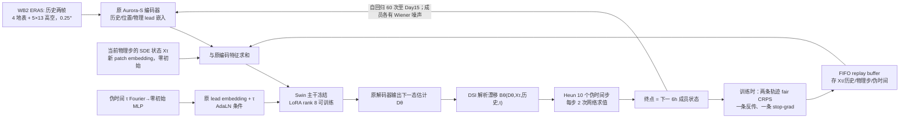

# Xaurora：从确定性 Aurora-S 微调出 15 天生成式集合预报

> Eliot Walt、Miltiadis Kofinas、Nikolaj Mücke、Efstratios Gavves、Dim Coumou，[*Xaurora: Generative Weather Forecasting with Denoising Stochastic Interpolants from a Foundation Model Prior*](https://arxiv.org/abs/2610.06509)，2026-10-05 首发，**arXiv:2610.06509v1**（53 页，42 图）。本笔记依据[作者 v1 全文 HTML](https://arxiv.org/html/2610.06509v1)的正文、方法附录 A、Table 1–7 和所述主要图注；截至 2026-10-16 未找到可取代该稿的正式期刊版。这里不转载原图，不从曲线像素读出不存在的逐日小数。相关但**不同研究**的 [2025 年谱一致性 S2S Xaurora 会议摘要](../s2s/05-xaurora-egu-abstract.md)保留独立条目；本稿与该摘要有共同第一作者，但题名、合作者、方法与实际评测时效均不同。

版本辨识还要更细：[2026 EMS 同名摘要](https://meetingorganizer.copernicus.org/EMS2026/EMS2026-650.html)与本稿**五位作者相同、随机插值＋LoRA 主线相近**，应作为这一路线的先前摘要而不再计一篇新论文；但 EMS 文本写“1.3B Aurora、漂移预测、operational”，本篇主结果明确是 **113M Aurora-S、终点状态去噪参数化、ERA5 训练/评测**，只有未充分训练的 Aurora-L 另做消融。不能把会议宣传版的 1.3B 业务成绩或任务列表直接当成本篇已完成实验。[EMS 官方摘要](https://meetingorganizer.copernicus.org/EMS2026/EMS2026-650.html)、[arXiv §4–5/Table 3](https://arxiv.org/html/2610.06509v1)

## 一、研究问题与证据级别

本文的问题不是从头发明一个天气底座，而是：已有的**确定性** Aurora 能否低成本转成会产生多条物理上连续天气轨迹的生成式集合？常规扩散从纯噪声生成下一状态，不能直接复用一个已经会做下一步确定性预报的网络；直接把随机扰动叠在旧预报上也无法自动训练长时效的集合可靠度。作者提出 Denoising Stochastic Interpolants（DSI）：在每个 **6 小时物理步**内部，从当前天气态沿一个**伪时间 SDE**走到下一天气态，再让每个成员把自己生成的状态用于下一物理步。不同 Wiener 噪声实现给出集合成员；Aurora-S 是起点，不是训练目标中的物理真值。[§2、§4](https://arxiv.org/html/2610.06509v1)

主结果是 **2022 年全球、0.25°、最多 15 天、10 成员**的预报评分。作者报告 Xaurora 的集合均值在很多 lead 的 uRMSE 优于 Aurora-S/L，fair CRPS 接近业务集合，且单张 A100 上**单条 15 天轨迹**约 13 分钟；然而原始集合通常欠离散，Z500 等大尺度变量在短时效又可能过离散，谱上存在顽固高波数噪声平台。`接近业务`是作者的曲线描述，不等于同一初值、真值和年份下严格胜过 IFS ENS/GenCast-O。[§5、A.4、Table 7](https://arxiv.org/html/2610.06509v1)

**归档**：主要实测范围 6 小时到第 15 天，因此归 `medium-range/`；论文没有第 3–6 周 S2S 技巧评测。它不是 [2025 EGU 谱一致性 Xaurora](../s2s/05-xaurora-egu-abstract.md)的公开性能表，也没有证明新稿保留了那份摘要所述 lead 条件回归头和频域解码器。[arXiv 题名/作者](https://arxiv.org/abs/2610.06509)、[2025 EGU 摘要](https://meetingorganizer.copernicus.org/EGU25/EGU25-9956.html)

## 二、数据、字段、处理和时间切分

| 环节 | v1 明确披露 | 阅读时的限定 |
| --- | --- | --- |
| 监督资料 | WeatherBench2 的 ERA5 子集，原 ERA5 被取为 **6 小时**一帧、全球 **0.25°、721×1440**；论文给出的 Zarr 路径为 `gs://weatherbench2/datasets/era5/1959-2023_01_10-wb13-6h-1440x721.zarr`。 | 路径总覆盖 1959–2023 **不等于训练用了全部年份**；Xaurora 的训练/验证/测试是 **1979–2020／2021／2022**。 |
| 动态输入/输出 | 两个连续状态 `(t−6h,t)` 预测 `t+6h`；4 地表场：2T、MSL、10U、10V；5 高空变量 T、Z、U、V、Q 各取 **13 个气压层**：50、100、150、200、250、300、400、500、600、700、850、925、1000 hPa，总计 **4+5×13=69**。 | 本模型清单**没有总降水 TP**；不应把该文的湿度或气压技巧冒称降水概率评分。正式 Table 2 将 Z 单位标为 `m` 并称 geopotential；与部分天气评测的 `m²/s²` 口径可能不同，不能擅自换算表 1 的 309.9。 |
| 业务参考 | HRES-T0 使用 WeatherBench2 的 `2016-2022-6h-1440x721.zarr`，供业务版模型初值/真值比较；作者明确说**业务系统对 HRES-T0、非业务 Aurora 与 Xaurora 对 ERA5**。 | HRES-T0 不等同 Xaurora 微调监督资料。作者承认跨这两组模型不严格可比，故不做统一胜出百分比排行榜。 |
| 归一化与新输入 | 沿用 Aurora **逐变量标准化统计量**；对新增 SDE 状态用 DSI/EDM 式预条件 `c(τ)≈[α(τ)²+β(τ)²+τγ(τ)²]^{-1/2}`，使平均尺度近于单位方差；伪时间用 Fourier 特征，波长范围 `10^-6` 到 `1`。 | 近似式忽略相邻物理态相关项；原文未给本研究新算的逐变量均值/标准差文件、缺测掩码与训练样本索引，不能自行发明清洗/插值或声称已复算。 |

训练用标准化后的 **6h 状态三元组**，并在回放轨迹里根据对应验证时刻取 `t+6h` 监督。原始 ERA5 是再分析，不是原始卫星直达预报；本篇也刻意**不建模生成初始条件的数据同化不确定性**。评测时为了降低输出存储，只保存所有地表量和 **250/500/700/850 hPa** 四层，不能把评分图覆盖的层数写成全 13 层均已逐日评分。[§2.1、A.1、A.3.2、A.4.3](https://arxiv.org/html/2610.06509v1)

## 三、模型结构：Aurora、DSI、双重时间轴如何拼接

本图是据[§4 与 Figure 3/6、Algorithms 2–3](https://arxiv.org/html/2610.06509v1)原创重绘，**不是**复制论文 Figure 1/3/6。物理时间 `t` 每次跳 **6h**；伪时间 `τ∈[0,1]` 仅是当前 6h 内的生成积分，不应把 `10 个 SDE 步`误写为 `10 个天气预报时次`。第 15 天对应 **60 个**6h 物理步，通常每步有 20 次神经网络求值。图中的回放箭头是训练路径，部署预测无监督 CRPS。[Algorithm 2、Table 7](https://arxiv.org/html/2610.06509v1)

**为什么能从 Aurora 暖启动。** 普通随机插值直接学漂移 `B` 或噪声 `W`，初始网络输出并非 Aurora 原来擅长的下一天气状态。DSI 改为让去噪器 `Dθ(Xτ,h,τ)`预测终点 `x(t+6h)`，由解析式把该估计和当前态组合成漂移；`α=1−τ、β=τ、γ=1−τ`，在 `γ` 分母靠近终点时下限截至 **0.05**。新增的 SDE 状态 patch embedding 和伪时间 MLP 采用零初始，使初始函数与 Aurora-S 等价；线性 `β=τ` 可保有这点，作者附录的二次 `β=τ²` 则在 `τ=0` 的初始漂移不指向预训练预测。这里的 2D 玩具例证明**该设定的起始映射**，不代表所有扩散/随机插值模型普遍不如 DSI。[§4.1–4.2、Fig. 2、App. A.6.4](https://arxiv.org/html/2610.06509v1)

**哪些权重改变。** 基座 Aurora-S 为约 **113M** 参数；原有 Swin Transformer 主体冻结，只用 **rank 8 LoRA** 调整主干。新增的 LoRA **540,672**、SDE 状态嵌入 **49,664**、伪时间嵌入 **131,584**，合计 **721,920** 新参数，即约 **+0.64%**（Table 4）。作者为“预存参数”和“新参数”分别设学习率，故“**仅训练这 721,920 个参数**”不是 Table 6 能支持的表述：旧参数中 Swin 主体之外哪些编码/解码层逐层可训练，v1 未给完整 `requires_grad` 清单。Aurora-L 的 +**3,475,456 / 0.28%**只是结构与额外消融，不是主评分 Xaurora 的 113M 底座规模。[§4.4、Table 3/4/6](https://arxiv.org/html/2610.06509v1)

## 四、训练与微调：不是单步去噪预训练的简单复用

作者实际主训练并非 Appendix Algorithm 1 的“用真实未来态构造插值 `Iτ` 然后最小化 L2”的 vanilla DSI。那样的中间状态含真实终点，推理时不存在，存在目标信息泄入输入的风险。主方法从 `τ=0` 的当前天气态启动**模型自己生成的 SDE 轨迹 `Xτ`**，只把真值放进评分损失；两条不同噪声轨迹走相同物理初值，一条计算梯度，另一条 stop-gradient 只提供成员距离。[§4.3、A.6.2–A.6.3](https://arxiv.org/html/2610.06509v1)

两成员 fair CRPS 损失可写为 `0.5(|f1−y|_ω+|f2−y|_ω)−0.5|f1−f2|_ω`：前项促使各成员接近真值，后项防止集合塌缩。监督成员每次随机选，另一成员停止梯度；作者论证其梯度期望为完整对称目标梯度的一半，驻点不变，节省反传。训练权重沿用 Aurora：地表变量整体 **0.25**、高空整体 **1**；变量系数 MSL/10U/10V/2T/Z/Q/T/U/V 分别 **1.5/0.77/0.66/3.0/2.8/0.8/1.7/0.87/0.6**，**训练损失无纬度加权**。这和验证时带纬度权重的全球 uRMSE/CRPS/SSR 不是同一个聚合式。[Eq. 9、A.6.2、A.4.1](https://arxiv.org/html/2610.06509v1)

训练缓冲区为每个 rank 容量 **16** 的 FIFO，FP16 存 SDE 状态、两帧历史、物理步数、伪时间和滚动深度；网络梯度计算为 FP32。每次抽一对状态、做 **2 次前向/1 次反向**、推进伪时间一步，走到 `τ=1` 就完成一个物理 6h 步并开始下一步；随机注入新样本（`p=0.005`），完成/过旧轨迹退出。最大物理滚动深度 **12 步=72h**，平均 SDE 步数 **10**，伪时间步长抖动 `j=0.5`；附图 8 报告训练所见平均伪时间约 **0.5**、平均深度 **4.7**。因此“训练时最多 72h”与“部署可滚动 15 天”是不同概念。回放样本较旧带来轻微 off-policy；作者给出年龄诊断，但不能把它当成严格无偏的全 15 天梯度。[Fig. 3/8/9、App. A.6.3、Table 6](https://arxiv.org/html/2610.06509v1)

### 主稿公开的实际数值（Table 6/7）

| 配置 | v1 数值 | 解释/未披露处 |
| --- | --- | --- |
| 数据与时长 | **50 万**训练样本；1979–2020 训练、2021 验证、2022 测试；16×80GB A100 约 **42 小时** | Aurora-S 权重原本已预训；42h **不含底座预训练**。 |
| 有效 batch / 更新 | 每 GPU micro-batch **1**，梯度累积 **4**，16 ranks；名义有效 batch **64**，每 rank **7,812** 次 backward | `500000/64≈7812.5`；采样去重、起报分布及最后不完整 batch 的处理未披露。 |
| 优化 | AdamW、**weight decay 0**、全局梯度范数裁剪 **1**、FP32、dropout/drop-path 均 **0** | AdamW 的 β/ε、随机种子、epoch 长度、选择最终 checkpoint 的逐项规则未披露。 |
| 学习率 | 781 步 warm-up；旧参数起点 0、峰值/终点均 **5×10⁻⁵**；新增参数起点 0、峰值 **1×10⁻³**、终点 **5×10⁻⁵**；文称余弦退火 | 分组**不能**被简写成“所有参数统一 1e−3”；文中没有旧权重 trainable mask 的完整清单。 |
| 生成 | `α=1−τ, β=τ, γ=1−τ`；每物理 6h 步 Heun **10** 个伪时间积分步 / **20 NFE**；主评 **10 成员** | 默认噪声独立高斯；论文的相关噪声干预在推理阶段，**不是主训练另加的一轮微调**。 |

Table 7 的 Aurora-L、Aurora-S、Aurora 1.5 与 Xaurora **不同预训/微调起点**。作者列 Aurora-L 3.8M 样本/32 A100/约两周预训，Aurora-S 3.8M 样本但时长/卡数未知，Aurora 1.5 为在 Aurora-O 上另用 2.1M 样本/24–32 A100/约两周概率微调；Xaurora 的 500k/16 A100/42h 相比之下较少。这个表不能算成“从零训练 Xaurora 只需 42h”，也没有给同硬件、同实现的 GenCast/ATLAS 端到端成本。[Table 6/7、§A.8](https://arxiv.org/html/2610.06509v1)

## 五、验证协议、原表性能、反例

**主评：**2022 年均匀分布的 **56 次起报**（00 或 12 UTC），全球 0.25°，Xaurora **10 成员**，最长 **15 天**；主图 Figure 4 绘 uRMSE、**fair** CRPS、SSR，附图 29–33 扩展变量/谱。uRMSE 从集合均值平方误差扣 `样本方差/M`，fair CRPS 用成员—真值绝对差减成员间绝对差的公平项，减小成员数差异；SSR 为 spread/uRMSE，**1 附近**代表整体尺度相当，不保证每个格点、极端分位或空间相关性都可靠。所有主评指标有纬度权重。作者自己运行 Aurora-S/L/O 预报；IFS ENS/GenCast-O 的业务分数取自 WeatherBench 存档，跨业务与非业务组**初值和分析真值不同**。主图没有对所有跨模型曲线做配对显著性检验。[§5.1、A.4.1–A.4.4](https://arxiv.org/html/2610.06509v1)

### Table 1：同一 Xaurora-S 家族消融，第 5 天

第一行是**绝对值**，后续为 `100×(1−M_变体/M_Xaurora)`，越正说明变体优于主 Xaurora；负数说明主 Xaurora 较好。只在该 5 天、56 起报和表内同类实验协议比较；† 为 95% 配对 bootstrap 下差异不显著。Z500 单位依稿内 Table 2 标 `m`，Q850 `kg/kg`，不把数值误当标准化无单位量。[Table 1、A.4.2](https://arxiv.org/html/2610.06509v1)

| 模型/训练变化 | Z500 uRMSE | Q850 uRMSE | Z500 fair CRPS | Q850 fair CRPS |
| --- | ---: | ---: | ---: | ---: |
| **Xaurora-S 主配置：replay + CRPS + DSI** | **309.9 m** | **1.52×10⁻³ kg/kg** | **139.4 m** | **7.55×10⁻⁴ kg/kg** |
| Aurora-S 确定性先验 | −15.4% | −18.2% | 不适用 | 不适用 |
| 单步＋MAE | +0.0%† | +0.1%† | −1.3%† | −6.5% |
| 课程滚动＋MAE | +3.1% | +1.0% | −4.1% | −15.5% |
| replay＋MAE | +1.4%† | +2.5% | −4.7% | −14.9% |
| 终点预测＋DDPM | −85.5% | −31.8% | −116.5% | −45.3% |
| 直接漂移 `B` 预测 | −89.7% | −33.3% | −1315.1% | −205.2% |
| 噪声 `W` 预测 | 训练发散 | 训练发散 | 训练发散 | 训练发散 |

Table 1 **并不**支持“CRPS 优化在全部指标胜过 MAE”：MAE 课程训练在第 5 天 Z500/Q850 的 uRMSE 分别好 **3.1%/1.0%**，却牺牲 CRPS **4.1%/15.5%**。附录 Figure 27 的 **15 天**配对曲线才显示大约第 6–7 天以后 replay+CRPS 的两类评分常显著领先单步 MAE；不能将第 5 天表格和第 15 天曲线写成同一个时间点。直接预测 `W` 在约 **70 更新步**出现无穷大梯度，单步 MAE 在约 **200 backward/12,800 样本**最佳后过拟合。Aurora-L 暖启动另有 Table 1 **325.9 m / 1.65×10⁻³ kg/kg** 的五天 uRMSE 和 **153.5 m / 8.71×10⁻⁴ kg/kg** CRPS，但只做了**单步 MAE**且未收敛，不能称为已完成的 1.3B 参数概率 replay 版。[Table 1、§5.3、B.3.1–B.3.4](https://arxiv.org/html/2610.06509v1)

### 时效曲线与成本表：正面主张后面的限定

| 图表/范围 | 作者明确给出的结果 | 必要限定 |
| --- | --- | --- |
| Figure 4，2022 56 起报、第 1–15 天 | Xaurora-S 集合均值通常第 **1 天以后**优于 Aurora-S、第 **3 天以后**优于 Aurora-L；部分变量在第 **7–12 天以后**低于 Aurora-O 的误差；第 15 天各系统整体 SSR 约 1。 | 是作者对曲线的概述；**没有**可抄的逐 lead 全变量原表小数。Aurora-O 在 10 天训练滚动范围外出现曲线不连续，比较并非同一训练目标。 |
| Figure 4/5，短时效与谱 | 6h Z500 fair CRPS 不占优；6h–3d 大尺度变量短期过离散，Q/U/V 等中尺度变量欠离散；Z500 **12h/5d** 谱在约 **k=31** 后出现噪声平台。 | “第 15 天全球 SSR≈1”掩盖低波数欠离散与高波数过离散的抵消；不能推导极端或空间联合校准。 |
| Table 7，单 A100 80GB | Xaurora-S 单成员 **6h 13.1s / 24h 52.3s**，每 6h 步 20 NFE；Aurora-S **0.6s / 2.4s**（1 NFE），Aurora-L **2.0s / 8.2s**；Aurora-L 初始化但未充分训练的 Xaurora **54.6s / 218.2s**。 | **15 天约 13 分钟**由 60×13.1s 得**单轨迹**，非“整个 10 成员集合串行 13 分钟”。并行成本/吞吐、不同机器基线不可直接按这张表排名。 |
| Figure 5、补录 Figure 11–17 | 在 **8 个**起报上改推理噪声幅度、颜色、球谐白噪声、误差谱拟合；能局部改善 SSR，但误差谱拟合噪声使较长时效 RMSE 增加。 | 这些是**同 checkpoint 的推理干预**，不是新训练成绩；8 起报无法支撑稳定的全非洲/全球业务增益。 |

**结果的物理解释与作者主张须分开。** 作者把高波数功率平台视为 denoiser/SDE 噪声构造的关键限制；在多个求解器、先验、训练时长与目标下仍可见。阅读判断是：低频低离散、短期高频过离散同时存在，因而只报告标量 SSR 的“近 1”会遗漏多尺度不可靠。作者的噪声拟合实验支持扩散项有关，却未通过完全匹配计算成本的因果消融排除架构、统计真值噪声和训练规范化的全部影响。[§5.2、B.1–B.2](https://arxiv.org/html/2610.06509v1)

## 六、能复现到哪里、不能证明什么

1. **训练可追踪，但不是可即刻完整复跑。** 论文给了数据公开路径、变量/层、归一化继承、算法与大量超参，却未在原文给出 Xaurora 专用代码/权重仓库、数据抽样序列、全部随机种子、检查点择优规则、优化器 β/ε、旧权重逐层冻结掩码及存储/成员并行脚本。现有文字不足以逐位复现 Table 1/7。不能借 Aurora 公共代码默认值代填这些缺口。
2. **没有业务同化不确定性。** 从 ERA5 初值生成成员只变化 SDE 过程；现实观测误差与 DA 初值扰动被刻意排除。与真正业务 IFS ENS 的概率覆盖比较，不能直接说两者物理不确定性来源已对齐。[§2.1](https://arxiv.org/html/2610.06509v1)
3. **对业务基线不是同协议。** IFS ENS/GenCast-O 使用 HRES-T0，Xaurora 与 Aurora-S/L 用 ERA5；作者明确承认真值/初值差异，且业务版分数部分下载而非 56 次配对重跑。相对曲线可作背景参照，不适合计算新的严格胜率或显著性。[A.4.2–A.4.4](https://arxiv.org/html/2610.06509v1)
4. **能力范围仅为报告字段、区域与时效。** 本稿没有独立的热带气旋路径、降水 TP、站点、极端尾部 proper score 或 S2S 周平均技能表；Figure 40–42 的天气场外观不是极端事件概率校准。15 天之后会怎样，不可外推。
5. **训练量与模型大小的比较必须保留既有底座成本。** `500k/42h` 是从已经预训练好的 Aurora-S 增量微调；对“从零做概率天气模型”的总 GPU-hours 没有同起点比较。AIFS/GenCast/ATLAS 的效率与该模型跨论文评估协议、硬件和 6h/12h 单步定义不齐，不能只看秒数下定论。[A.8/Table 7](https://arxiv.org/html/2610.06509v1)

## 七、阅读结论

这是一篇有完整方法附录的**15 天中期集合生成**论文，价值在于把确定性基础模型作为下一状态去噪先验，以**零初始化新条件＋冻结 Swin/LoRA＋SDE 双时间滚动回放＋单反传 fair CRPS**形成一条资源受控的概率微调路径。Table 1 同时展示其权衡：在第 5 天，MAE 课程模型可赢 uRMSE，Xaurora 才在 CRPS 上较稳；谱分析又显示全球 SSR 好看并不等于每个空间尺度校准。最值得复现的是**同 ERA5 初值、同 56 起报、同样 10 成员**下的 replay+CRPS 对单步/课程 MAE、以及噪声协方差对 CRPS/空间联合技巧的配对实验；跨 HRES-T0 的业务排名和 2025 S2S 摘要的结果应继续分开。[v1 原文](https://arxiv.org/html/2610.06509v1)

[返回中期目录](../../README.md#中期预报) · [总追踪表](../../气象大模型_中期预报论文追踪.md)
