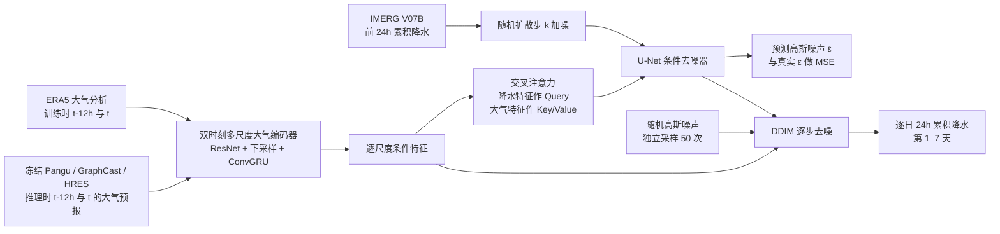

# Diffusion Precipitation Generation with Medium-range Weather Forecasting：冻结天气底座后的观测监督降水扩散生成

## 书目信息与阅读边界

- **作者**：Guowen Li、Yang Liu、Mengxuan Chen、Jiashun Cheng、Haoyuan Liang、Shilei Cao、Yujie Wang、Juepeng Zheng、Fang Wang、Yerong Feng、Meng Jin、Hong Cheng、Yutong Lu、Haohuan Fu。
- **来源**：[arXiv:2610.12976](https://arxiv.org/abs/2610.12976)，初版／本笔记所读版本均为 **v1，2026-10-09**；[v1 完整 HTML](https://arxiv.org/html/2610.12976v1)。本笔记依据 v1 正文、附录 A.1–A.3、表 1–3，不把其他研究的配置填入此稿。
- **任务**：用已有天气系统预报的**非降水大气场**，条件生成与 IMERG Final Run V07B 对齐的逐日 24 小时累积降水。主实验最长 **168 小时／第 7 天**，不是第 10–15 天预报，也不含次季节评测。因研究对象是日尺度天气预报的中期前段，归在 `medium-range/` 的过渡方法；检索严格 10–15 天技巧时应排除。
- **论文定位**：Pangu-Weather、GraphCast 或 HRES 是冻结的大气预报提供者；本文新训练的是 **110.3M 参数的条件降水生成器**。它既不是将 IMERG 直接微调进三套预报底座，也不是从底座已有降水场做简单偏差订正或空间超分辨。

## 一、研究问题：为什么“换降水监督”没有那么简单

作者认为以再分析降水作监督的天气模型，降水场可能与卫星—雨量计融合产品 IMERG 存在地区和雨强相关偏差。若将整个 GraphCast 或同量级系统改用 IMERG 重训，成本高；另一方面，24 小时累计雨量是对不断变化的大气状态的响应，直接回归容易产生平滑的局地雨峰。因此作者把动力过程与降水生成解耦：先由任一可兼容的冻结底座给出未来温度、风、湿度等，再让独立训练的随机生成器给出雨量。

这项贡献的关键不是“扩散能画出更尖的雨峰”这个视觉主张，而是一个**跨变量、跨底座复用**的实验设计：生成器只从 ERA5 大气分析场与 IMERG 目标学习，推理时直接接入不同底座的预报场。同一分辨率共享一套生成器参数；**0.25° 和 1.5° 分别训练**，不能视作无代价跨分辨率迁移。是否可复用的判断应同时看数值误差、事件检出、概率评分和接入开销；不能只看图 4 的视觉锐度。[原文 §1、§4.1、§5.1、§6](https://arxiv.org/html/2610.12976v1)。

## 二、数据、时间切分与处理

| 角色 | 原文披露的内容 | 阅读时应注意的边界 |
| --- | --- | --- |
| 条件场 | **逐小时 ERA5** 的非降水变量，按有效时刻与目标配对；静态为陆海掩膜、地形；地表为 T2m、U10、V10、MSLP；高空为 Z@50/100/150、U@200/250/300、V@400/500/600、T@700/850、Q@925/1000。 | 此列表严格照附录表 3，不以惯常 13 层字段替换。压力层单位在表中未印，按变量命名理解为气压层；具体原生单位／字段编码需查数据字典。 |
| 目标场 | **IMERG Final Run V07B**；以有效时刻 `t` 对齐前 24 小时 `(t−24,t]` 的累计降水。 | 文章说明配对与目标窗口，但未完整披露 IMERG 原始半小时率到日累计的算法、缺测遮罩、海陆覆盖、质量控制及单位换算实现。 |
| 外部预报 | HRES、ENS 取自 **WeatherBench2**；GraphCast、Pangu-Weather 用公开模型生成预报。 | 底座是条件场来源或对照；只有后接生成器接受新训练。Pangu 没有原生降水输出，不能做“原生降水 vs 增强降水”的同构对照。 |
| 网格 | 全球 **1.5°** 与区域/高分辨率 **0.25°** 对齐。 | 论文说所有产品对齐并在相同网格使用同一变量、单位与归一化接口，但**没有**给出完整插值算子、保守性处理、边界与极区处理、逐变量归一化统计表。两个分辨率各有独立 checkpoint。 |
| 时段 | 总资料覆盖 **1998–2023**；**1998–2021 训练，2023 验证，2022 测试**。 | 验证年 2023 晚于测试年 2022，需保留原顺序，不改写成“顺时间切分”。用训练期计算 ACC 气候态，减少评分泄漏。 |
| 独立点验 | 中国气象局 **2,288 站**，用于华北 2022 年 7 月初一次强降水个例。 | 它是个例的外部站点验证，不能充当全年全球站点泛化证据。 |

详见[原文 §5.1、附录表 3 与 A.2](https://arxiv.org/html/2610.12976v1)。文章把数据对齐描述到网格/单位/归一化接口层面，但缺乏可逐步复刻的数据清理、重网格权重、归一化公式、雨量非负处理和样本起报索引清单；这些在此不臆造。

## 三、模型与前向流程（原创重绘）

图为依据[原文 §4.1–4.2、图 2](https://arxiv.org/html/2610.12976v1)重新绘制的**训练／推理逻辑示意**，不是转载原图，也不表示底座误差通过训练反传。编码器每层有残差卷积、GroupNorm/SiLU、下采样，并在双时刻特征上用 ConvGRU 提取变化；首个压缩级声称把 `C×H×W` 变为 `4C×H/4×W/4`，特征体积降至 1/4。U-Net 去噪器在匹配尺度用降水特征作为 `Q`、大气条件作为 `K/V` 的交叉注意力，输出与噪声降水同形状的预测噪声。作者没有给出足以一比一复刻的各级深度、通道数、注意力头数或完整模块配置，示意图不填虚构层数。

形式上每个有效时刻 `t∈{24,48,…,168}h` 输出一张 `t−24` 到 `t` 的逐日雨量；默认条件是预测时刻 `t−12h` 与 `t` 的两个大气场，训练采用对应 ERA5 时刻。正向扩散将真雨场按噪声表扰动成 `Yᵏ=√ᾱₖY⁰+√(1−ᾱₖ)ε`；编码器 `τθ(Xₜ₋₁₂,Xₜ)` 与 U-Net 一起最小化 `E||ε−εθ(Yᵏ,k,τθ)||²`。每个雨量成员从独立高斯噪声起步；**给定同一大气轨迹反复采样**衡量的是条件降水不确定性，不等价于分别扰动初始条件、动力模型的全流程大气集合。[原文式 (5)–(12)、§6](https://arxiv.org/html/2610.12976v1)。

## 四、训练流程、公开参数与微调

1. 以 1998–2021 的 ERA5 双时刻非降水场与同一有效时刻前 24 小时 IMERG 累积雨量成对监督，分别建立 1.5° 与 0.25° 的生成器。训练条件场是**分析场**，不是 Pangu/GraphCast/HRES 的误差积累后预报场。
2. 从 `K=1000` 个扩散时间步抽 `k`，对 IMERG 真雨加标准高斯噪声，编码大气条件，学习噪声预测 MSE；编码器与去噪器都由此目标更新，三个预报底座不反传。框架 PyTorch；**300,000 更新步**；**AdamW，学习率 1×10⁻⁵，β=(0.9,0.99)**；实验硬件 **4×NVIDIA A800**。[原文 §4.1、§5.1](https://arxiv.org/html/2610.12976v1)。
3. 推理时将对应分辨率的已训生成器直接接在冻结底座的大气预报后，默认 **DDIM 100 步**。全球概率评估每个条件场抽 **50 个独立雨量样本**；确定性评分只使用一张生成样本，无人工挑选。没有逐底座主方法微调。[原文 §5.1](https://arxiv.org/html/2610.12976v1)。
4. **确有微调，但只作为负面诊断**：从同一 ERA5 训练的生成器 checkpoint 起步，改用预报场—IMERG 对更新**生成器**，底座仍冻结；与零更新的直接复用作对照。文章报告了目标和更新范围，但未说明这一诊断的训练起报年/数量、精确步数、微调学习率、batch、冻结生成器内部哪几层、早停或选择规则。因此不能把它当成熟的增益阶段。[附录 A.3](https://arxiv.org/html/2610.12976v1)。

文章**未披露**训练 batch size、学习率调度、权重衰减、EMA、梯度裁剪、训练墙钟时间、随机种子、每一尺度的网络层宽/深、归一化均值方差、β 噪声日程的具体数列及诊断微调完整超参。不能从四张 A800 或 30 万步反推这些设置。附录仅报告新生成器 **110.3M 参数、每张生成样本约 0.33 秒、额外峰值显存约 8 GB**（对应其所述配置），不是完整底座加生成器生成七天 50 成员集合的端到端延迟。[附录 A.3](https://arxiv.org/html/2610.12976v1)。

## 五、评测协议、数值与正反结果

全球 1.5° 的 2022 年预报以 IMERG 为真值，基线为 Pangu、GraphCast、HRES 的可比原生降水能力，以及概率对照 ENS/GenCast；高分辨率 0.25° 另在美国、南部非洲、澳大利亚评测，并用 2,288 个站点评价一个华北强降水个例。全球格点评分含纬度余弦权重，ACC 的气候态仅用 1998–2021 训练段；事件阈值为 0.1、1、4 mm，BS 用 **0.1 mm**，HSS 的二元阈值也是 0.1 mm。CRPS 用固定 50 成员的传统样本估计，不应与 fair-CRPS 或不同集合规模的原始数值直接混排。[原文 §5.1、附录 A.2](https://arxiv.org/html/2610.12976v1)。

### 全球 1.5°、2022 年、50 成员：逐日概率评分

以下数字**直接转录原文表 1**；CRPS 对雨量场计分、BS 为无量纲概率平方误差。原表未在表头单列 CRPS 单位，本文不擅自给表值加 `mm` 标签。更低为好，以下同列是**同一论文按其协议**给出的系统级对照，仍要注意原生 ENS/GenCast 的大气轨迹不确定性与本文“固定大气轨迹下的雨量生成”不同。

| 指标 | 系统 | 第 1 天 | 第 3 天 | 第 5 天 | 第 7 天 |
| --- | --- | ---: | ---: | ---: | ---: |
| CRPS ↓ | ENS | 1.528 | 1.824 | 2.161 | 2.484 |
| CRPS ↓ | GenCast | 1.512 | 1.778 | 2.147 | 2.368 |
| CRPS ↓ | Pangu＋本文 | 1.483 | 1.756 | 2.061 | 2.336 |
| CRPS ↓ | GraphCast＋本文 | **1.477** | **1.660** | **1.898** | **2.180** |
| CRPS ↓ | HRES＋本文 | 1.525 | 1.747 | 2.006 | 2.302 |
| BS ↓，0.1 mm 事件 | ENS | 0.193 | 0.211 | 0.237 | 0.245 |
| BS ↓，0.1 mm 事件 | GenCast | 0.177 | 0.209 | 0.230 | 0.247 |
| BS ↓，0.1 mm 事件 | Pangu＋本文 | 0.141 | 0.164 | 0.200 | 0.240 |
| BS ↓，0.1 mm 事件 | GraphCast＋本文 | **0.138** | **0.155** | **0.181** | **0.218** |
| BS ↓，0.1 mm 事件 | HRES＋本文 | 0.140 | 0.154 | 0.185 | 0.219 |

[原文表 1](https://arxiv.org/html/2610.12976v1)。**保留反例**：第 1 天 HRES＋本文的 CRPS 1.525 比 GenCast 1.512 **差**；因此“所有配置在所有时效都优于所有集合”不成立。GraphCast＋本文在原表报告的 1–7 天 CRPS 与 BS 均最小，但这只是该稿所用数据、预处理、目标真值和集合定义下的结果；不能推广到 10–15 天，更不能由 BS 改善直接推断强降水极尾也校准。

### 第 1 天模块消融：相同数据切分与作者协议

| 条件／生成器 | ACC ↑ | RMSE ↓ | HSS ↑ | CSI@0.1mm ↑ | CSI@4mm ↑ |
| --- | ---: | ---: | ---: | ---: | ---: |
| GraphCast 原生 | 0.6091 | 6.120 | 0.5347 | 0.5097 | 0.4271 |
| GraphCast 条件＋ConvGRU、无对齐模块 | 0.6217 | 5.924 | 0.5914 | 0.5612 | 0.4826 |
| GraphCast 条件＋ConvLSTM、无对齐模块 | 0.5942 | 6.318 | 0.5165 | 0.4942 | 0.3945 |
| GraphCast 条件＋注意力、无时序模块 | 0.6571 | 5.721 | 0.6213 | 0.6158 | 0.5185 |
| GraphCast 条件＋ConvGRU、交叉注意力（完整） | **0.7015** | **5.590** | **0.6832** | **0.6736** | **0.5340** |
| HRES 原生 | 0.6394 | 6.010 | 0.5164 | 0.5126 | 0.4151 |
| HRES 条件＋ConvGRU、交叉注意力（完整） | **0.6978** | **5.650** | **0.6818** | **0.6742** | **0.5221** |

[原文表 2](https://arxiv.org/html/2610.12976v1)。作者同时试了门控对齐、U-Net、CorrDiff，完整配置综合最强；但是单独 U-Net 在 GraphCast 条件下的 **CSI@0.1mm 为 0.6458，高于单独 ConvGRU 0.5612**，说明不能把每个删减对照都描述成全指标单调变差。表 2 RMSE 的原表头未注明显式单位，保持原值而不以猜测写为 `mm/day`。作者的正文还称 GraphCast＋本文平均 ACC 提高 0.103、RMSE 降低 0.623；这是跨 lead 平均，勿与表 2 的第 1 天差值混同。[原文 §5.2–5.4](https://arxiv.org/html/2610.12976v1)。

### 采样效率、输入密度与负面微调

| 对照 | 原文明确数字 | 解释与限制 |
| --- | --- | --- |
| 两个 12h 条件场 vs 四个 6h 条件场 | GraphCast 条件下平均 RMSE **6.520 vs 6.518**；原生 GraphCast **7.143**；本文接口的生成开销 **0.33s vs 0.84s**。 | 四帧仅低 0.002 的 RMSE，作者采用双帧节约时间。与另一图的 GraphCast 6.522 不强行合并；可能实验/统计口径不同，原文未足够解释。 |
| 直接复用 vs 预报场微调 | GraphCast 条件平均 RMSE **6.522 → 6.947**；Pangu 条件 **6.825 → 7.088**，均变差。 | 这是附录 A.3 诊断；说明本实验里追随带 lead 误差的预报场训练**没有**提升，不能推断所有微调策略必然无效。 |
| DDIM 步数 | 10→100 步持续改善，100→250 步曲线基本饱和。 | 图 7 为曲线；不从曲线臆造逐步的精确 RMSE/ACC。 |
| 高分辨率/站点 | 美国、南非、澳大利亚 0.25° 图示；华北 **2,288 站**个例。 | 原稿主文主要给图形与定性结论，这里不读图虚构地区或站点精确增益。 |

[原文图 5–7、附录 A.3 图 8–10](https://arxiv.org/html/2610.12976v1)。单次华北个例说明雨带和局地峰值可能更贴近站测，但不是每季、每气候区、各强雨阈值的总体站点技巧。图 4 的更锐利雨带并非替代 RMSE/CSI/CRPS 的证据。

## 六、作者结论、我的判断与复现缺口

**作者主张**：从 ERA5—IMERG 对学习的扩散生成器在多个冻结底座间可复用，日雨量确定性与概率指标相对原生或外部系统具有竞争力；ConvGRU 时序摘要和跨场交叉注意力互补，预报场微调在已试配置下反而有损。[原文 §5–6](https://arxiv.org/html/2610.12976v1)。

**阅读判断**：第一，最强证据限于 **Day1–7/2022/指定 IMERG 目标与对齐流程**，对本库 10–15 天重点只是方法候选，不是已证实的第 2 周成绩。第二，这个 50 成员集合主要抽样固定底座轨迹条件下的雨量残差，和 ENS/GenCast 的完整大气轨迹集合在不确定性来源上不同；同表分数可作任务级比较，不能推断其动力集合更优。第三，ERA5 分析场训练到预报场推理存在分布转移；附录扰动与微调诊断支持在测试范围内直接复用，但未证成所有底座／分辨率／季节的无缝迁移。第四，使用 IMERG 做训练与验证目标时，其检索/地形/极端雨不确定性不会因为模型更贴近 IMERG 而自动消失；单个站点个例是重要外部证据却范围有限。

**复现仍缺**：变量的完整下载及版本标识、IMERG 汇聚和缺测方案、保守重网格/坐标与归一化参数、训练 batch/种子/调度/网络配置/噪声日程、预报场微调具体协议、逐个底座的起报清单与公平配对、站点检验的掩码与匹配算法、全流程七天×50 成员延迟及完整代码权重均不能从 v1 文本核验。这里把这些明确列为“未披露／不可核验”，不据此否定表内结果，也不把缺失参数编成伪复现说明。
